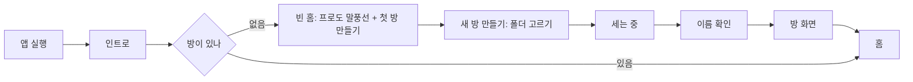
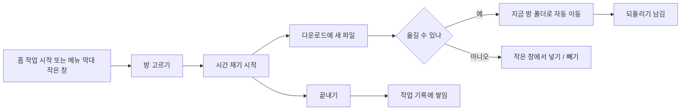
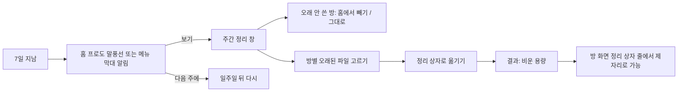

# Folduct 정보구조 · 메뉴 구조도

2026-11-16 · 코드(apps/room) 기준으로 지금 앱에 있는 그대로 적었어요.

그림판(FigJam): [Folduct 메뉴 구조도와 플로우 3개](https://www.figma.com/board/RQ2wvPloNcc18P5pmioFyO)

Folduct의 핵심 기능은 두 가지예요. 모든 화면은 이 둘 중 하나를 돕거나, 둘을 쓰게 해 주는 바탕이에요.

- **A. 새 파일은 제자리로**: 작업 중 들어온 파일을 지금 방으로 옮겨요.
- **B. 안 쓰는 파일은 상자로**: 주간 정리로 오래 안 쓴 파일을 방 안 정리 상자에 모아요.
- **바탕**: 방 만들기·찾기·설정처럼 A·B를 쓰기 위한 화면이에요.

표시: (앱) 데스크톱 앱에만, (웹) 웹에만, 표시 없음은 둘 다.

---

## 1. 메뉴 구조도

```
Folduct
├─ 인트로 (실행할 때 자동 · 환경설정에서 다시 보기)
│
├─ 홈  #/
│  ├─ 머리
│  │  ├─ [주간 정리] ─────────────→ 주간 정리 창
│  │  ├─ [메뉴] ──────────────────→ 메뉴 창
│  │  ├─ [+ 새 방] ───────────────→ 새 방 만들기 창
│  │  └─ [톱니] ──────────────────→ 환경설정 창
│  ├─ 방 카드 줄 (최대 5개)
│  │  ├─ 누르기·끌어 놓기 → 프로도가 먹음 → 먹은 방 파일
│  │  ├─ 먹은 카드 한 번 더 누르기 → 방 화면
│  │  └─ 오른쪽 클릭 → 방 메뉴 [방 설정] [홈에서 빼기]
│  ├─ 프로도
│  │  ├─ 주간 정리 말풍선 [보기] [다음 주에]
│  │  └─ 작업 줄 (앱) [작업 시작] → 방 고르기 / [멈춤] [끝내기]
│  ├─ 먹은 방 파일
│  │  ├─ 찾기 칸 · 형식 칩
│  │  └─ 파일 누르기 ─────────────→ 미리보기 창
│  ├─ 현관 줄 (오늘 새 문서) → 누르기 → 옮길 방 메뉴
│  ├─ 일력 카드 ──────────────────→ 작업 기록 판
│  │                                 ├─ 진행 중 (현관 · [주간 정리])
│  │                                 └─ 추세 (작업 시간 · 요일별 · 방별)
│  └─ 형식별로 보기 (아래로 스크롤)
│     ├─ [형식별 | 컬러별]
│     └─ 서랍 누르기 → 목록 종이 → 파일 누르기 → 미리보기 창
│
├─ 방 화면  #/room/<id>
│  ├─ 머리 [← 돌아가기] [폴더 다시 보기] [방 설정]
│  ├─ 찾기 · 색 거르기 · 용량
│  ├─ 줄 4개: 새로 왔어요 / 요즘 써요 / 잠잠해요 / 정리 상자
│  └─ 고른 파일 서랍
│     ├─ [파일 열기] → 파일 보기 창
│     ├─ [아직 써요] [고정] [정리 상자에 넣기] [제자리로]
│     └─ 버전 기록
│
├─ 창(다이얼로그)
│  ├─ 메뉴: 정리와 도구(이번 주 정리 · 작업 보고 · 샘플 방) · 방 목록 · 요약과 보는 법
│  ├─ 환경설정: 인트로 · 플로팅 창(앱) · 상태 확인 주기(앱) · AI 요약(앱) · 현관 폴더(앱)
│  ├─ 새 방 만들기: 폴더 고르기 → 세는 중 → 이름 확인 → 방 화면
│  ├─ 방 설정: 이름 · 방 색 · 방 썸네일 · 방 돌보기 · 방 지우기
│  ├─ 홈에 둘 방 고르기 (방이 5개를 넘으면 자동)
│  ├─ 주간 정리: 오래 안 쓴 방 · 방별 오래된 파일 → 정리 상자로
│  └─ 작업 보고: 기간별 시간 · 한 일 · AI 정리(앱)
│
└─ 메뉴 막대 (앱)
   ├─ 아이콘 누르기 → 작은 창: 방 고르고 작업 시작 · 새 파일 넣기/빼기 · 정리 알림 · [앱 열기]
   ├─ 플로팅 프로도 (띄워 두기 켰을 때): 같은 메뉴를 프로도에서
   └─ 오른쪽 클릭: 플로팅 창 보이기/숨기기 · Folduct 열기 · 끝내기
```

---

## 2. 화면 정의서

| 화면 | 하는 일 | 기능 | 왜 여기에 있나 | 들어오는 곳 | 나가는 곳 |
|---|---|---|---|---|---|
| 인트로 | 프로도가 흩어진 파일을 삼키며 앱의 말(색=형식, 길이=용량)을 알려 줘요 | 바탕 | 첫 화면에서 한 번에 개념을 보여 주려고 | 실행, 환경설정 [다시 보기] | 홈 |
| 홈 · 방 카드 줄 | 지금 하는 방 5개를 그림으로 보여 줘요 | 바탕 | 방을 이름이 아니라 그림으로 구분하려고 | 홈 | 프로도 먹이기, 방 화면 |
| 홈 · 프로도 | 먹인 방의 용량(길이)과 형식(색)을 한 몸으로 보여 줘요 | 바탕 | 방 상태를 한눈에, 한 번에 한 방만 | 방 카드 | 먹은 방 파일 |
| 홈 · 작업 줄 (앱) | 어느 방에서 일하는지 정하고 시간을 재요 | A | 작업 중인 방이 정해져야 새 파일이 갈 곳이 생겨요 | 프로도 아래 | 메뉴 막대 창과 같이 움직임 |
| 홈 · 먹은 방 파일 | 그 방 파일을 찾고 형식으로 좁혀요 | 바탕 | 방 화면에 안 들어가도 바로 찾으려고 | 프로도 먹이기 | 미리보기 창 |
| 홈 · 현관 줄 | 오늘 들어온 새 문서를 보여 주고 방으로 보내요 | A | 작업 밖에서 들어온 파일도 제자리로 | 홈 위, 작업 기록 판 | 옮길 방 메뉴 |
| 홈 · 주간 정리 말풍선 | 정리할 때가 되면 프로도가 권해요 | B | 메뉴를 찾지 않아도 때를 알려 주려고 | 7일마다 자동 | 주간 정리 창 |
| 홈 · 일력과 작업 기록 판 | 올해 작업한 날과 방별 시간을 보여 줘요 | A 결과 | 작업한 흔적을 남겨 다시 오게 하려고 | 일력 카드 | 주간 정리(진행 중 카드) |
| 홈 · 형식별 서랍장 | 모든 방의 파일을 형식·색으로 한데 모아 봐요 | 바탕 | 방을 기억 못 해도 "그 PDF"를 찾으려고 | 아래로 스크롤 | 목록 종이 → 미리보기 창 |
| 미리보기 창 | 파일을 보고 이름·메모·썸네일을 바꿔요 | 바탕 | Finder까지 가지 않고 홈에서 끝내려고 | 먹은 방 파일, 서랍 목록 | 기본 앱, Finder |
| 방 화면 | 한 방을 날짜 줄 4개로 보고 하나씩 정리해요 | B | 오래된 파일이 어디 있는지 날짜로 보여 주려고 | 먹은 카드 다시 누르기, 메뉴 방 목록 | 홈 |
| 메뉴 창 | 도구 모음과 전체 방 목록 | 바탕 | 홈에 없는 방(뺀 방 포함)과 드문 기능을 모으려고 | 머리 [메뉴] | 방 화면, 주간 정리, 작업 보고 |
| 환경설정 창 | 인트로·플로팅 창·AI·현관 폴더 | 바탕 | 한 번 정하면 잘 안 바꾸는 것 | 머리 톱니 | 없음 |
| 새 방 만들기 창 | 폴더 하나로 방 하나를 만들어요 | 바탕 | 방이 있어야 A·B가 돌아가요 | [+ 새 방], 빈 홈 [첫 방 만들기] | 방 화면 |
| 방 설정 창 | 이름·색·썸네일·홈에 둘지·지우기 | 바탕 | 방마다 다르게 꾸미고 관리하려고 | 방 메뉴(오른쪽 클릭), 방 화면 | 홈 |
| 홈에 둘 방 고르기 | 홈 5개 제한을 지키게 골라요 | 바탕 | 지금 하는 일만 보이게 | 6번째 방이 생길 때 자동 | 홈 |
| 주간 정리 창 | 안 쓴 파일을 골라 정리 상자로 옮겨요 | B | 지우지 않고 한 번에 치우려고 | 머리, 메뉴, 말풍선, 작업 기록 판, 메뉴 막대 알림 | 홈 |
| 작업 보고 창 | 기간별 작업 시간과 한 일을 정리해요 | A 결과 | 한 주를 돌아보려고 | 메뉴, 자동 보고 알림(앱) | 없음 |
| 메뉴 막대 작은 창 (앱) | 앱을 열지 않고 작업 시작·새 파일 넣기 | A | 다른 앱을 쓰는 중에도 바로 | 메뉴 막대 아이콘 | 앱 열기, 주간 정리 |
| 플로팅 프로도 (앱) | 작은 창과 같은 일을 화면 위에서 | A | 전체 화면 앱 위에서도 보이게 | 환경설정, 작은 창 [띄워 두기] | 앱 열기 |

---

## 3. 핵심 플로우

### 플로우 1. 처음 쓰기



### 플로우 2. 작업 중 새 파일 (기능 A)



### 플로우 3. 주간 정리 (기능 B)



---

## 4. 구조도를 그리며 드러난 문제

| 번호 | 문제 | 지금 | 고칠 방향 |
|---|---|---|---|
| 1 | 숨은 입구 | 방 설정과 홈에서 빼기는 홈에서 오른쪽 클릭으로만 열려요 | 방 카드에 보이는 ⋯ 단추 |
| 2 | 방 추가·제거가 안 보여요 | 추가는 머리 [+ 새 방]뿐, 제거는 오른쪽 클릭 → 방 설정 → 지우기 | 방 카드 줄 끝에 + 카드, ⋯ 메뉴에 빼기·지우기 |
| 3 | 서랍에서 방으로 못 가요 | 서랍 목록이 "나머지는 방 안에서 찾아 주세요"라고 하지만 방으로 가는 링크가 없어요 | 목록 종이와 미리보기 창에 방 이름 링크 |
| 4 | 같은 파일, 다른 창 | 홈은 미리보기 창, 방 화면은 파일 보기 창. 썸네일 바꾸기 이름도 서로 달라요 | 하나로 맞추기 |
| 5 | 방 화면이 막다른 길 | 방 화면에서 메뉴·주간 정리·다른 방으로 못 가고 돌아가기만 있어요 | 머리에 다른 방 바로 가기 |
| 6 | 방을 들어가는 법이 안 보여요 | 먹은 카드를 한 번 더 누르면 들어가는데 화면에 안내가 없어요 | 먹은 카드에 [방 열기] 표시 |
| 7 | 서랍장을 모를 수 있어요 | 홈 아래 스크롤에만 있어요 | 머리나 프로도 근처에 입구 |
| 8 | 빠져나갈 수 없는 창 | 홈에 둘 방 고르기는 Esc도 닫기도 없어요 | 닫기 허용(나중에 고르기) |
| 9 | 방 분류가 없어요 | 방은 이름·색·썸네일만 있어요 | 방에 분류(예: 학교·회사·개인) 붙이고 홈에서 거르기 |
| 10 | 주간 정리 입구가 6곳 | 머리·메뉴·말풍선·작업 기록 판·메뉴 막대·(웹) 자동 | 말풍선·머리 두 곳으로 줄이기 검토 |
